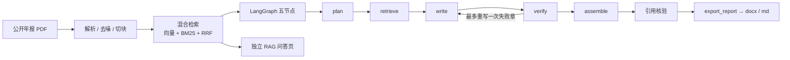

# doc2report-agent

把公开上市公司年报 PDF 转成带页码引用的 Word 分析报告，并附带可单独演示的 RAG 知识库问答页。

本项目基于公开数据与原创实现，MIT License。

## 截图

以下为真实 Streamlit 界面截图（`scripts/screenshots.py` + Playwright 驱动上传/入库/提问/生成，等运行结束再截；无摆拍文案；第 8 轮重拍）。生成的 `.docx` 留在本地 `output/`（不入库）。

### 报告生成


<!-- Word 打开图由作者本机拍摄后放入 docs/images/word-open.png，再取消下一行注释：

-->

### 独立问答


## 架构



## 快速开始

需要 Python 3.11+（本机实测 3.12.10）。以下命令均在仓库根目录执行。

样本：自行下载一份公开上市公司年报 PDF，放到 `data/samples/`（该目录与 `*.pdf` 已 gitignore，不入库）。下文以 `data/samples/public-annual-report-2024.pdf` 为例。

### Windows（PowerShell）

```powershell
python -m venv .venv
.\.venv\Scripts\Activate.ps1
python -m pip install -U pip
python -m pip install -e ".[dev,qa,embedding]"
Copy-Item .env.example .env
# 编辑 .env：填入 API_KEY（.env.example 默认 RETRIEVER=memory；Windows 上若误设 milvus 会自动回落）

# 首次使用显式下载本地向量模型（权重不入库；运行时不会静默联网）
python -m core.index.embeddings --download-model
```

### Linux / WSL / macOS

```bash
python3 -m venv .venv
source .venv/bin/activate
pip install -U pip
pip install -e ".[dev,qa,embedding,milvus]"
cp .env.example .env
# 编辑 .env：填入 API_KEY；默认 RETRIEVER=memory，Linux 可改 milvus

python -m core.index.embeddings --download-model
```

### `.env` 示例

```dotenv
BASE_URL=https://api.deepseek.com
API_KEY=<你的 Key，勿提交>
MODEL=deepseek-flash
# Windows 用 memory；Linux/WSL/macOS 可用 milvus
RETRIEVER=memory
EMBEDDING_BACKEND=local
EMBEDDING_MODEL=BAAI/bge-small-zh-v1.5
EMBED_DEVICE=
MIN_VECTOR_SCORE=0.35
```

### 三个入口

| 入口 | Windows | Linux / WSL / macOS |
| --- | --- | --- |
| 报告生成页 | `streamlit run app\report.py` | `streamlit run app/report.py` |
| 独立问答页 | `streamlit run app\rag.py` | `streamlit run app/rag.py` |
| 命令行 | `python -m core.graph.run --pdf data\samples\public-annual-report-2024.pdf --download-model` | `python -m core.graph.run --pdf data/samples/public-annual-report-2024.pdf --download-model` |

- 命令行成功后，在 `output/`（已 gitignore）写出 `.md` 与 `.docx`。
- 加 `--summary-json output/run-summary.json` 可导出逐章核验状态、【待核实】句数和耗时。
- `--download-model` 只在缺模型时下载；已缓存可省略。
- 未配置 `API_KEY` 时，解析入库后退出并提示。

### 运行测试

Windows（避开系统 Temp 下 pytest 目录的权限问题，每次用新的 basetemp）：

```powershell
python -m pytest -q -rs -p no:cacheprovider --basetemp=$env:LOCALAPPDATA\Temp\d2r-pytest-<新目录名>
```

Linux：

```bash
python -m pytest -q -rs -p no:cacheprovider --basetemp=/tmp/d2r-pytest-<新目录名>
```

## 配置项

| 变量 | 默认 | 说明 |
| --- | --- | --- |
| `BASE_URL` | `https://api.deepseek.com` | OpenAI 兼容接口 |
| `API_KEY` | （空） | 仅从 `.env` 读取，勿提交 |
| `MODEL` | `deepseek-flash` | 非思考模式 |
| `RETRIEVER` | `memory`（`.env.example` 默认）；未设置时 Windows=`memory`、其它=`milvus`；win32 上 `milvus` 自动回落 `memory` 并打日志 | 检索后端 |
| `EMBEDDING_BACKEND` | `local` | `local` / `fake`（测试） |
| `EMBEDDING_MODEL` | `BAAI/bge-small-zh-v1.5` | 本地向量模型 |
| `EMBED_DEVICE` | 自动 | `cuda` / `cpu`；有 CUDA 默认 GPU |
| `EMBED_QUERY_INSTRUCTION` | BGE 中文检索前缀 | 只加在查询上；置空关闭 |
| `MIN_VECTOR_SCORE` | `0.35` | 相关性门槛（待实测） |
| `PARSER` | `pymupdf` | PDF 引擎 |

## 测试结果

最新窄修复（2026-10-29）：**199 passed、11 skipped、1 warning**（4.48s）。新增14项否定披露守卫回归。命令：`python -m pytest -q -rs -p no:cacheprovider --basetemp=C:\Users\xjsab\AppData\Local\Temp\d2r-disclosure-full-20261029`。证据与边界见[修复日志](docs/devlog/2026-10-r9-disclosure-guard.md)。下表保留先前版本实测。

| 环境 | 命令 | 结果 |
| --- | --- | --- |
| Linux（Debian 13，Python 3.13.5，第 9 轮 [v1-ready]） | `python -m pytest -q -rs -p no:cacheprovider --basetemp=/tmp/d2r-pytest-r9-t3` | 193 passed, 0 skipped, 0 failed |
| 原生 Windows 11（第 9 轮 [v1-ready]，Python 3.12.10） | `python -m pytest -q -rs -p no:cacheprovider --basetemp=C:\Temp\d2r-pytest-r9-t3b` | 185 passed, 11 skipped, 0 failed |

Windows 上的 11 个 skip 都是 Milvus Lite 契约测试（原生 Windows 不可用）。第 9 轮笔记本已复测：[v1-ready] 185 passed, 11 skipped（Python 3.12.10；已删 eval 相关单测）。

### 端到端实测（2026-10-29补充验收，非基准）

- 原生Windows 11、Python 3.12.10、RTX 3050 Laptop GPU；现有模型配置，CLI使用memory检索器。
- 原公开年报本次CLI实跑：`python -m core.graph.run --pdf data/samples/public-annual-report-2024.pdf --out-dir output/r9-acceptance --summary-json output/r9-acceptance/run-summary.json`。
- 解析77.7s，入库145.1s，graph 177.3s，总计400.5s；待核实0处。
- 本次最终pytest：**185 passed、11 skipped、1 warning**（13.23s）；命令 `python -m pytest -q -rs -p no:cacheprovider --basetemp=C:\Users\xjsab\AppData\Local\Temp\d2r-r9-acceptance-final-20261029`。

| 章 | 核验状态 | 重写次数 | 待核实数 | 引用页 | 召回页 | 耗时(s) |
| --- | --- | ---: | ---: | --- | --- | ---: |
| 公司概况 | supported | 0 | 0 | 6,7,26,88 | 6,7,26,33,87,88 | 27.8 |
| 主营业务 | supported | 0 | 0 | 23,26,153,154 | 9,23,26,64,153,154 | 21.4 |
| 财务表现 | supported | 0 | 0 | 7,8,68 | 7,8,67,68,69,92 | 27.3 |
| 风险因素 | supported | 1 | 0 | 2,30,31,167 | 2,27,30,31,167 | 62.6 |
| 结论 | supported | 0 | 0 | 9,23,25,29,43 | 9,23,25,29,43 | 19.3 |

完整原句、公司信息及引用、产物文件名见[补充验收日志](docs/devlog/2026-10-r9-acceptance.md)。截图来自脚本独立运行的真实Streamlit，不是CLI输出截图。正文仍含“待核验”和数据缺失陈述；0处仅统计【待核实】精确标记。数字核验supported不等于完整语义正确，模型输出也可能随重跑变化。

## 已知局限

- **Milvus Lite 不支持原生 Windows**：`.env.example` 默认 `RETRIEVER=memory`；若仍写成 `milvus`，工厂在 win32 上会打日志并回落到 `memory`。完整 Milvus Lite 请用 Docker / WSL / Linux / macOS。
- **否定披露窄守卫**：仅对两种已知句式，在当前实际引用片段具有完整表格行时纠正“未包含明细/未显示毛利率”；缺列、跨块或错页保留警示。不是通用语义核验。
- **核验粒度**：含数字的句子会把数字与引用页原文逐个比对；不含数字的句子只校验引用（文件、页码存在，且该页在本章检索到的片段内），不判断语义是否正确。
- **比率只算四类**：同比增速（营业收入、净利润）、毛利率、净利率、资产负债率。其余指标不做代码计算。
- **毛利率可能缺失**：「分行业 / 分产品」表若以列标题形式排列（营业收入、营业成本各占一列），目前抽不出「营业成本」行，因此可能算不出毛利率；写作者可能标【待核实】。v1 不扩列表头表抽取（见 ROADMAP / 已知局限）。
- **括号负数不支持**：抽取时不会把 `(1,234.56)` 这类会计括号写法识别为负数。
- `MIN_VECTOR_SCORE=0.35` 目前只用一份公开年报调过，仍需更多样本调参。
- 写作模型偶尔仍可能把内部词写进正文；assemble 会清理 `calc_financials` /「写作上下文」，仍建议人工通读。
- 模板 v1 只有「年报分析」一种。
- 本地 embedding **不会**在运行时静默联网：缺模型时请显式执行 `python -m core.index.embeddings --download-model`，或给 CLI 加 `--download-model`，或设置 `EMBEDDING_ALLOW_DOWNLOAD=1`。模型权重不入库。
- Word 打开图：`docs/images/word-open.png` 由作者本机拍摄后提交；文件不存在时 README 中对应图片行保持注释。也可直接打开 `output/` 里的 `.docx`（不入库）。
- 不提交 PDF、`.env`、密钥、模型文件、`output/` 与生成的报告。
- 核心函数入口与签名见 [docs/core-api.md](docs/core-api.md)。

## v2 计划

- Elasticsearch 二级检索作为第二个 Retriever
- MCP 对外暴露工具、Docker 一键起、完整评估集
- FastAPI /tools、业务平台与前端（见 `docs/ROADMAP.md`）
- langgraph 大版本升级评估

## 约束

详见 [AGENTS.md](AGENTS.md)、[功能要求](docs/CODEX_PROMPT.md)、[工具规范](docs/TOOLS_SPEC.md)、[路线图](docs/ROADMAP.md)。
