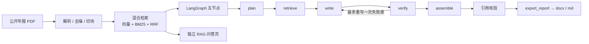

# doc2report-agent

把公开上市公司年报 PDF 转成带页码引用的 Word 分析报告，并附带可单独演示的 RAG 知识库问答页。

本项目基于公开数据与原创实现，MIT License。

## 截图

> 截图见 [`docs/images/`](docs/images/)。第 5 轮实跑后补齐；若某张缺失，见下方「已知限制」。

| 场景 | 文件 |
| --- | --- |
| 报告页生成进度 | `docs/images/report-progress.png` |
| 报告预览（展开引用） | `docs/images/report-preview.png` |
| Word 打开效果 | `docs/images/word-open.png`（可能需人工补拍） |
| 问答页有引用回答 | `docs/images/qa-cited.png` |
| 问答页拒答 | `docs/images/qa-refuse.png` |

## 架构



## 安装

需要 Python 3.11+。

**Windows cmd**

```bat
cd /d path\to\doc2report-agent
python -m venv .venv
.venv\Scripts\activate.bat
python -m pip install -U pip
python -m pip install -e ".[dev,qa,embedding]"
copy .env.example .env
REM 编辑 .env：填入 API_KEY（勿提交）
```

**Linux / WSL**

```bash
cd /path/to/doc2report-agent
python3 -m venv .venv
source .venv/bin/activate
pip install -U pip
pip install -e ".[dev,qa,embedding]"
cp .env.example .env
# 编辑 .env：填入 API_KEY（勿提交）
```

可选：Linux/macOS/WSL/Docker 下 `pip install -e ".[milvus]"` 并设置 `RETRIEVER=milvus`。原生 Windows 请用 `RETRIEVER=memory`。

## 启动

### 独立问答页

**Windows cmd**

```bat
.venv\Scripts\activate.bat
streamlit run app\rag.py
```

**Linux / WSL**

```bash
source .venv/bin/activate
streamlit run app/rag.py
```

### 报告生成页

**Windows cmd**

```bat
.venv\Scripts\activate.bat
streamlit run app\report.py
```

**Linux / WSL**

```bash
source .venv/bin/activate
streamlit run app/report.py
```

### 命令行生成报告

**Windows cmd**

```bat
.venv\Scripts\activate.bat
python -m core.graph.run --pdf data\samples\public-annual-report-2024.pdf
```

**Linux / WSL**

```bash
source .venv/bin/activate
python -m core.graph.run --pdf data/samples/public-annual-report-2024.pdf
```

成功后在 `output/`（已 gitignore）写出 `.md` 与 `.docx`。未配置 `API_KEY` 时解析入库后退出并提示。

## 配置项

| 变量 | 默认 | 说明 |
| --- | --- | --- |
| `BASE_URL` | `https://api.deepseek.com` | OpenAI 兼容接口 |
| `API_KEY` | （空） | 仅从 `.env` 读取，勿提交 |
| `MODEL` | `deepseek-flash` | 非思考模式 |
| `RETRIEVER` | Windows=`memory`，其它=`milvus` | 检索后端 |
| `EMBEDDING_BACKEND` | `local` | `local` / `fake`（测试） |
| `EMBEDDING_MODEL` | `BAAI/bge-small-zh-v1.5` | 本地向量模型 |
| `EMBED_DEVICE` | 自动 | `cuda` / `cpu`；有 CUDA 默认 GPU |
| `EMBED_QUERY_INSTRUCTION` | BGE 中文检索前缀 | 只加在查询上；置空关闭 |
| `MIN_VECTOR_SCORE` | `0.35` | 相关性门槛（待实测） |
| `PARSER` | `pymupdf` | PDF 引擎 |

## 测试结果

本机（原生 Windows，Python 3.12.10）第 5 轮任务 3 [e2e] 后：

```text
python -m pytest -q -rs --basetemp=.tmp/pytest/basetemp
113 passed, 11 skipped, 0 failed
```

skip 均为原生 Windows 上的 Milvus Lite 契约。

## 已知限制

- Word 打开效果截图（`docs/images/word-open.png`）本轮未能无头稳定导出，需人工补拍（勿含用户名/路径/Key）。
- 真实端到端实跑中五章均有引用，但数字核验仍全部 mismatch／pending（见 `docs/devlog/2026-10-r5-e2e.md`）。

- 原生 Windows 不跑 Milvus Lite；请用 memory 或 Docker/WSL。
- `MIN_VECTOR_SCORE=0.35` 仍待真实年报调参。
- 模板 v1 仅「年报分析」一种。
- 本地 embedding 首次需下载模型权重（不入库）。
- 不提交 PDF、`.env`、密钥、模型文件、`output/` 与生成报告。

## v2 计划

- Elasticsearch 二级检索作为第二个 Retriever
- MCP 对外暴露工具、Docker 一键起、完整评估集
- FastAPI /tools、业务平台与前端（见 `docs/ROADMAP.md`）
- langgraph 大版本升级评估

## 约束

详见 [AGENTS.md](AGENTS.md)、[功能要求](docs/CODEX_PROMPT.md)、[工具规范](docs/TOOLS_SPEC.md)、[路线图](docs/ROADMAP.md)。
