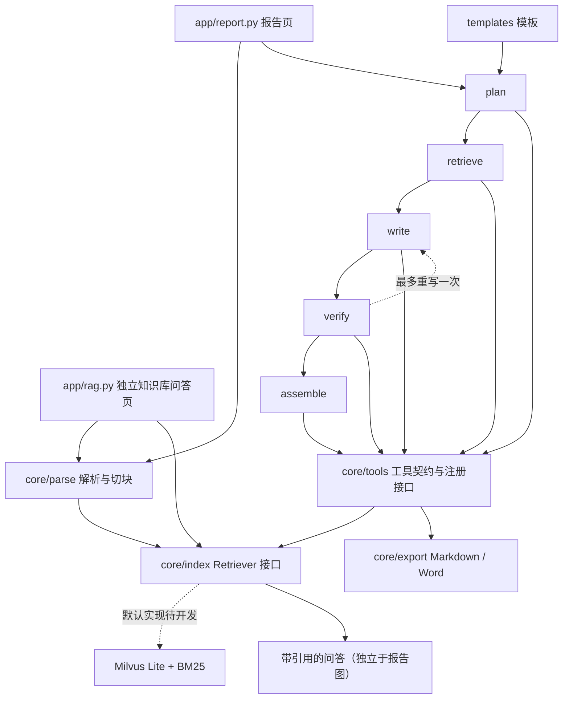

# doc2report-agent

文档 → 报告智能体：计划将上市公司公开年报 PDF 转为可溯源的企业经营分析报告，并导出 Word。

An open-source project for source-backed reports and standalone RAG Q&A over public annual reports.

本项目基于公开数据，与任何机构的内部系统无关。所有代码、提示词、样例均须原创。MIT License。

## 当前范围

第 2 轮已完成脚手架评审小改、`core/parse` 的 PDF 解析与切块，以及 `parse_document` 工具。
默认使用 PyMuPDF，保留从 1 开始的物理页码，抽取文字、标题和表格；MinerU 可选，未安装、接口不兼容或执行失败时记录 warning 并回退。
其余业务入口仍为占位；未接入模型、向量库、LangGraph 运行时、Streamlit、MCP 或文件导出，完整 Demo 尚未实现。
约束以 [AGENTS.md](AGENTS.md) 为准，另见 [功能要求](docs/CODEX_PROMPT.md)、[工具规范](docs/TOOLS_SPEC.md)、[路线图](docs/ROADMAP.md)。

## 架构（规划）



## 目录与接口

- `app/`：报告入口与独立 RAG 入口占位。
- `core/parse/`：`parse_pdf(file_path, engine="pymupdf") -> ParsedDocument` 和 `chunk_document(document, min_chars=500, max_chars=800, overlap=100) -> list[Chunk]`。
- `core/export/`：导出模块占位。
- `core/index/retriever.py`：`Retriever.index_chunks(chunks)`、`search(query, doc_ids=None, top_k=8, mode="hybrid")`。
- `core/models.py`：片段、检索结果、来源、事实、模板及泛型工具返回结构。`Chunk` 含 `doc_id`、`section`、`page_end`（省略或为空时等于 `page`），`SearchHit` 继承 `Chunk` 并增加 `score`。
- `core/graph/state.py`：LangGraph 兼容的 TypedDict；每章包含事实、引用、核验、重写计数和耗时/token 字段。重写次数约定为 0 或 1，运行时限制尚未实现。
- `core/tools/`：8 个工具模块，模板模块含 2 个函数，共 9 个操作。
- `templates/`、`scripts/`、`tests/`：模板说明、下载/评估入口和测试骨架。

## 工具层

各函数接收对应 Pydantic `*Input`，返回 `*Output = ToolResult[*Data]`。各工具提供中英文描述及版本元数据。
统一结构：`{ok: bool, data: object|null, error: str|null, sources: [{file, page, chunk_id}]}`，页码从 1 开始。
`ToolResult` 已校验：成功时 `error` 必须为 `None`；失败时必须有非空错误信息且 `data` 为 `None`。
`parse_document` 已记录工具名、文件名/引擎参数摘要、耗时和成功状态；`registry.py` 当前仅定义注册、日志结构和 `list_tools()` 签名，统一分发和其他工具日志留待实现。

| 模块/操作 | 输入要点 | 输出要点 |
| --- | --- | --- |
| parse_document（已实现） | file_path、engine | doc_id、pages、sections、tables；新增 chunks、实际 engine |
| search_chunks | query、doc_ids、top_k、mode；注入 Retriever | chunks，含文本/评分/出处 |
| get_table | doc_id、table_id 或 keyword | headers、rows、page、raw_text 回退 |
| calc_financials | 各财务原值的 current/previous、来源 | Decimal 指标值、公式、输入值及来源 |
| verify_claim | claim、source_chunk_ids | supported/not_found/mismatch、证据、差异 |
| render_section | section_name、template_id、facts | 带引用的 Markdown（待实现） |
| export_report | report_md、format、title | file_path |
| templates：list_templates / load_template | 空输入 / template_id | 模板列表 / 完整模板 |

工具不直接访问网络；样例下载是文档允许的例外。模型调用与工具层的具体边界留待实现阶段设计。
MCP、自动生成工具文档、实际注册分发和统一调用日志尚未实现。

## 快速检查（3 步）

目标 Python 3.11+；本轮本机验证版本和结果见下文。

1. `python -m venv .venv`，激活虚拟环境（Windows：`.venv\Scripts\Activate.ps1`）。
2. `python -m pip install -e ".[dev]"`（含 PyMuPDF 和 pytest）。
3. `python -m pytest -q`。

本轮默认解析无需 `.env` 或 API key，无模型调用或 PDF 下载。`app/report.py` 和 `app/rag.py` 仅为未来可分别启动的入口。

## 解析与切块

```python
from core.parse import parse_pdf, chunk_document
from core.tools.parse_document import ParseDocumentInput, parse_document

document = parse_pdf("data/samples/public-report.pdf")  # 自行准备公开年报，不提交 PDF
chunks = chunk_document(document)
result = parse_document(ParseDocumentInput(file_path="data/samples/public-report.pdf"))
if result.ok:
    print(result.data.doc_id, result.data.pages, len(result.data.chunks))
else:
    print(result.error)
```

解析结果仅在内存中返回，不写文件或建立索引。`ParsedDocument.pages` 保留逐页原文和段落块，`tables` 保留表头、二维行数据、页码及 `raw_text`；工具按既有契约返回表格摘要。
`doc_id` 取 PDF 内容的 SHA-256，同一文件内容改名不改变文档身份；`chunk_id` 在相同内容和切块参数下稳定。

切块先按标题分组，再优先使用段落边界，其次句子边界，长段落按字符截断。默认 500–800 个 Python 字符（包含内部空白），同章节相邻片段重叠 100 字；短章节保留为短块，尾块不足 500 字时扩大重叠。片段可以跨页，以 `page` / `page_end` 标出实际原文范围，不跨标题混合正文。
标题采用字号与编号启发式识别；复杂多栏、目录、重复页眉和无边框表格可能识别不准。表格检测失败会记录 warning，页内原文仍保留。空白/扫描页保留页码，默认不启用 OCR，整份无可提取文字时记录 warning；缺失、损坏或需密码的 PDF 返回失败工具结果。

可选开关为 `ParseDocumentInput(engine="mineru", ...)` 或 `parse_pdf(..., engine="mineru")`；默认依赖不安装 MinerU。本轮适配 [MinerU 4 本地 SDK](https://opendatalab.github.io/MinerU/usage/sdk_api/) 的 Flash/txt 模式，并通过 [Content List 渲染格式](https://opendatalab.github.io/MinerU/reference/output_files/) 保留原页码和表格原始标记；不支持的版本会记录原因并回退 PyMuPDF。表格原始标记暂不转换为二维单元格。`.env.example` 中 `PARSER` 的环境变量自动加载留待应用层实现。
PyMuPDF 文字和表格抽取接口见 [官方 Page 文档](https://pymupdf.readthedocs.io/en/latest/page.html)。

## 配置与模板

`.env.example` 预留 `BASE_URL`、`API_KEY`、`MODEL=deepseek-flash`、`RETRIEVER=milvus`、解析器及 embedding 配置。
本地 embedding 回退约定为 `BAAI/bge-small-zh-v1.5`，本轮不加载模型。
**低置信/待验证**：`MODEL_THINKING=false` 是项目拟定配置约定，尚未映射或验证供应商请求参数。
模板数据结构为 `template_id`、`title`、`sections[{name, questions, keywords}]`；后续在 `templates/` 添加 YAML 并实现加载器。

## 测试与未验证项

本轮验证（2026-10-25，Windows / Python 3.11.5，PyMuPDF 1.28.2，Pydantic 2.14.1）：

- 解析模块完成后：`.venv\Scripts\python.exe -m pytest -q` → **28 passed, 21 skipped**。
- 切块和工具接通后：同一命令 → **51 passed, 18 skipped**。
- `tests/conftest.py` 使用 PyMuPDF 在 pytest 临时目录现场生成原创小 PDF，覆盖中文标题、跨页正文和带边框表格，不提交任何 PDF。
- 已覆盖工具成功/失败结构、页码/章节/表格、稳定 ID、500–800 字切块及重叠/正文完整性、短章节隔离、损坏/缺失/加密文件、空白页、表格失败保留原文，以及 MinerU 缺失/运行失败回退与日志。
- 切块及 `parse_document` 的 skip 已解除；剩余 18 个跳过项为检索、引用核验占位及其余 8 个工具操作各 2 个正例/异常例占位。

未验证：真实安装 MinerU 的端到端运行及其本地资源依赖（适配器仅用替身测试，缺失回退已验证）、真实年报/扫描件 OCR/复杂跨页表格、多栏阅读顺序、Milvus Lite 平台支持及检索/引用核验、模型名及非思考参数、独立 RAG 页、导出、Docker 与 MCP。Python 3.11 已验证；其他 Python 版本本轮未复跑。
评估计划：引用覆盖率、待核实数字占比、每章耗时及 token 用量（`scripts/eval.py` 仅入口）。

## 展示与后续

效果截图：待 Demo 实现后补充。继续按每轮最多 2 个模块推进。
v1 补全报告流程及独立问答；后续考虑多文档对比、表格问答、Elasticsearch 检索、权限与私有化部署。
不提交密钥、PDF、向量库文件和导出的 Word。
