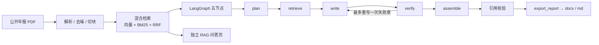

# doc2report-agent

把公开上市公司年报 PDF 转成带页码引用的 Word 分析报告，并附带可单独演示的 RAG 知识库问答页。

本项目基于公开数据与原创实现，MIT License。

## 截图

以下为真实 Streamlit 界面截图（`scripts/screenshots.py` + Playwright 驱动上传/入库/提问/生成，等运行结束再截；无摆拍文案；第 8 轮重拍）。Word 打开图本轮不拍，生成的 `.docx` 留在本地 `output/`（不入库）。

### 报告生成


### 独立问答


## 架构



## 快速开始

需要 Python 3.11+（本机实测 3.12.10）。以下命令均在仓库根目录执行。

样本：自行下载一份公开上市公司年报 PDF，放到 `data/samples/`（该目录与 `*.pdf` 已 gitignore，不入库）。下文以 `data/samples/public-annual-report-2024.pdf` 为例。

### Windows（PowerShell）

```powershell
python -m venv .venv
.\.venv\Scripts\Activate.ps1
python -m pip install -U pip
python -m pip install -e ".[dev,qa,embedding]"
Copy-Item .env.example .env
# 编辑 .env：填入 API_KEY，并把 RETRIEVER 改为 memory（原生 Windows 无 Milvus Lite）

# 首次使用显式下载本地向量模型（权重不入库；运行时不会静默联网）
python -m core.index.embeddings --download-model
```

### Linux / WSL / macOS

```bash
python3 -m venv .venv
source .venv/bin/activate
pip install -U pip
pip install -e ".[dev,qa,embedding,milvus]"
cp .env.example .env
# 编辑 .env：填入 API_KEY；RETRIEVER=milvus（默认）或 memory

python -m core.index.embeddings --download-model
```

### `.env` 示例

```dotenv
BASE_URL=https://api.deepseek.com
API_KEY=<你的 Key，勿提交>
MODEL=deepseek-flash
# Windows 用 memory；Linux/WSL/macOS 可用 milvus
RETRIEVER=memory
EMBEDDING_BACKEND=local
EMBEDDING_MODEL=BAAI/bge-small-zh-v1.5
EMBED_DEVICE=
MIN_VECTOR_SCORE=0.35
```

### 三个入口

| 入口 | Windows | Linux / WSL / macOS |
| --- | --- | --- |
| 报告生成页 | `streamlit run app\report.py` | `streamlit run app/report.py` |
| 独立问答页 | `streamlit run app\rag.py` | `streamlit run app/rag.py` |
| 命令行 | `python -m core.graph.run --pdf data\samples\public-annual-report-2024.pdf --download-model` | `python -m core.graph.run --pdf data/samples/public-annual-report-2024.pdf --download-model` |

- 命令行成功后，在 `output/`（已 gitignore）写出 `.md` 与 `.docx`。
- 加 `--summary-json output/run-summary.json` 可导出逐章核验状态、【待核实】句数和耗时。
- `--download-model` 只在缺模型时下载；已缓存可省略。
- 未配置 `API_KEY` 时，解析入库后退出并提示。

### 运行测试

Windows（避开系统 Temp 下 pytest 目录的权限问题，每次用新的 basetemp）：

```powershell
python -m pytest -q -rs -p no:cacheprovider --basetemp=$env:LOCALAPPDATA\Temp\d2r-pytest-<新目录名>
```

Linux：

```bash
python -m pytest -q -rs -p no:cacheprovider --basetemp=/tmp/d2r-pytest-<新目录名>
```

## 配置项

| 变量 | 默认 | 说明 |
| --- | --- | --- |
| `BASE_URL` | `https://api.deepseek.com` | OpenAI 兼容接口 |
| `API_KEY` | （空） | 仅从 `.env` 读取，勿提交 |
| `MODEL` | `deepseek-flash` | 非思考模式 |
| `RETRIEVER` | Windows=`memory`，其它=`milvus` | 检索后端 |
| `EMBEDDING_BACKEND` | `local` | `local` / `fake`（测试） |
| `EMBEDDING_MODEL` | `BAAI/bge-small-zh-v1.5` | 本地向量模型 |
| `EMBED_DEVICE` | 自动 | `cuda` / `cpu`；有 CUDA 默认 GPU |
| `EMBED_QUERY_INSTRUCTION` | BGE 中文检索前缀 | 只加在查询上；置空关闭 |
| `MIN_VECTOR_SCORE` | `0.35` | 相关性门槛（待实测） |
| `PARSER` | `pymupdf` | PDF 引擎 |

## 测试结果

两套环境均为真实运行结果（第 8 轮 [readme-v1prep] 最终代码）：

| 环境 | 命令 | 结果 |
| --- | --- | --- |
| 原生 Windows 11 家庭版 10.0.26300，Python 3.12.10，PowerShell 5.1 | `python -m pytest -q -rs -p no:cacheprovider --basetemp=$env:LOCALAPPDATA\Temp\d2r-pytest-r8g` | 174 passed, 11 skipped, 0 failed |
| Linux（Debian 13，Python 3.12.15，含 milvus 依赖：pymilvus 2.6.17 + milvus-lite 2.5.1） | `python -m pytest -q -rs -p no:cacheprovider --basetemp=/tmp/d2r-pytest-r8-linux2` | 185 passed, 0 skipped, 0 failed |

Windows 上的 11 个 skip 都是 Milvus Lite 契约测试（原生 Windows 不可用）；Linux 上这 11 个测试实际运行并通过。

### 端到端实测（仅本机一次运行，非基准）

- 环境：原生 Windows 11、Python 3.12.10、NVIDIA RTX 3050 Laptop GPU（torch 2.6.0+cu124，嵌入走 CUDA）、`MODEL=deepseek-flash`、`RETRIEVER=memory`。
- 样本：一份公开年报 PDF（约 4.5 MB）。
- 命令：`python -m core.graph.run --pdf … --summary-json …`
- 时间：2026-10-28 23:35（UTC+8）。

| 章节 | 核验 | 重写 | 【待核实】句数 | 耗时 (s) |
| --- | --- | --- | --- | --- |
| 公司概况 | supported | 0 | 0 | 12.2 |
| 主营业务 | supported | 1 | 2 | 42.1 |
| 财务表现 | supported | 1 | 3 | 62.8 |
| 风险因素 | supported | 0 | 0 | 17.5 |
| 结论 | supported | 0 | 0 | 16.5 |

各阶段耗时：解析 82.4 s，入库（嵌入）47.6 s，LangGraph 五节点 161.7 s，总计 292.0 s。模型输出有随机性，换机器、换模型或重跑，数字都会变化。

## 已知局限

- **Milvus Lite 不支持原生 Windows**：Windows 请设 `RETRIEVER=memory`（`.env.example` 默认写的是 `milvus`，复制后要改），或改在 Docker / WSL / Linux / macOS 下运行。
- **核验粒度**：含数字的句子会把数字与引用页原文逐个比对；不含数字的句子只校验引用（文件、页码存在，且该页在本章检索到的片段内），不判断语义是否正确。
- **比率只算四类**：同比增速（营业收入、净利润）、毛利率、净利率、资产负债率。其余指标不做代码计算。
- **毛利率可能缺失**：「分行业 / 分产品」表若以列标题形式排列（营业收入、营业成本各占一列），目前抽不出「营业成本」行，因此可能算不出毛利率，报告里不出现该项。
- **括号负数不支持**：抽取时不会把 `(1,234.56)` 这类会计括号写法识别为负数。
- `MIN_VECTOR_SCORE=0.35` 目前只用一份公开年报调过，仍需更多样本调参。
- 写作模型偶尔会把内部工具名（如 calc_financials）写进正文，需人工通读。
- 模板 v1 只有「年报分析」一种。
- 本地 embedding **不会**在运行时静默联网：缺模型时请显式执行 `python -m core.index.embeddings --download-model`，或给 CLI 加 `--download-model`，或设置 `EMBEDDING_ALLOW_DOWNLOAD=1`。模型权重不入库。
- Word 文档的打开效果不截图，请直接打开 `output/` 中生成的 `.docx`（不入库）。
- 不提交 PDF、`.env`、密钥、模型文件、`output/` 与生成的报告。
- 核心函数入口与签名见 [docs/core-api.md](docs/core-api.md)。

## v2 计划

- Elasticsearch 二级检索作为第二个 Retriever
- MCP 对外暴露工具、Docker 一键起、完整评估集
- FastAPI /tools、业务平台与前端（见 `docs/ROADMAP.md`）
- langgraph 大版本升级评估

## 约束

详见 [AGENTS.md](AGENTS.md)、[功能要求](docs/CODEX_PROMPT.md)、[工具规范](docs/TOOLS_SPEC.md)、[路线图](docs/ROADMAP.md)。
