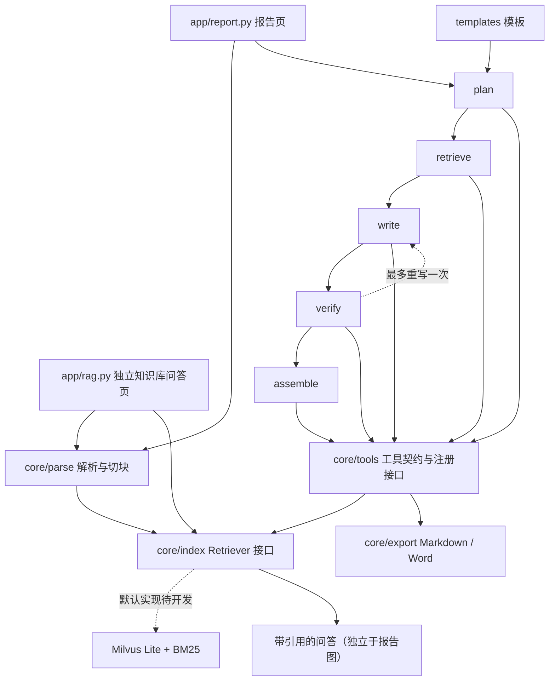

# doc2report-agent

文档 → 报告智能体：计划将上市公司公开年报 PDF 转为可溯源的企业经营分析报告，并导出 Word。

An open-source scaffold for source-backed reports and standalone RAG Q&A over public annual reports.

本项目基于公开数据，与任何机构的内部系统无关。所有代码、提示词、样例均须原创。MIT License。

## 当前范围

第 1 步仅交付目录、数据结构、接口和测试骨架，等待评审。业务入口均抛出 `NotImplementedError`。
未接入模型、解析器、向量库、LangGraph 运行时、Streamlit、MCP 或文件导出；暂无可运行 Demo。
约束以 [AGENTS.md](AGENTS.md) 为准，另见 [功能要求](docs/CODEX_PROMPT.md)、[工具规范](docs/TOOLS_SPEC.md)、[路线图](docs/ROADMAP.md)。

## 架构（规划）

## 目录与接口

- `app/`：报告入口与独立 RAG 入口占位。
- `core/parse/`、`core/export/`：解析和导出模块占位。
- `core/index/retriever.py`：`Retriever.index_chunks(chunks)`、`search(query, doc_ids=None, top_k=8, mode="hybrid")`。
- `core/models.py`：片段、检索结果、来源、事实、模板及泛型工具返回结构。
- `core/graph/state.py`：LangGraph 兼容的 TypedDict；每章包含事实、引用、核验、重写计数和耗时/token 字段。重写次数约定为 0 或 1，运行时限制尚未实现。
- `core/tools/`：8 个工具模块，模板模块含 2 个函数，共 9 个操作。
- `templates/`、`scripts/`、`tests/`：模板说明、下载/评估入口和测试骨架。

## 工具层

各函数接收对应 Pydantic `*Input`，返回 `*Output = ToolResult[*Data]`。各工具提供中英文描述及版本元数据。
统一结构：`{ok: bool, data: object|null, error: str|null, sources: [{file, page, chunk_id}]}`，页码从 1 开始。
成功/失败字段一致性和工具日志写入留待实现；`registry.py` 当前仅定义注册、日志结构和 `list_tools()` 签名。

| 模块/操作 | 输入要点 | 输出要点 |
| --- | --- | --- |
| parse_document | file_path、engine | doc_id、pages、sections、tables |
| search_chunks | query、doc_ids、top_k、mode；注入 Retriever | chunks，含文本/评分/出处 |
| get_table | doc_id、table_id 或 keyword | headers、rows、page、raw_text 回退 |
| calc_financials | 各财务原值的 current/previous、来源 | Decimal 指标值、公式、输入值及来源 |
| verify_claim | claim、source_chunk_ids | supported/not_found/mismatch、证据、差异 |
| render_section | section_name、template_id、facts | 带引用的 Markdown（待实现） |
| export_report | report_md、format、title | file_path |
| templates：list_templates / load_template | 空输入 / template_id | 模板列表 / 完整模板 |

工具不直接访问网络；样例下载是文档允许的例外。模型调用与工具层的具体边界留待实现阶段设计。
MCP、自动生成工具文档、实际注册分发和调用日志尚未实现。

## 快速检查（3 步）

目标 Python 3.11+；本轮本机验证版本和结果见下文。

1. `python -m venv .venv`，激活虚拟环境（Windows：`.venv\Scripts\Activate.ps1`）。
2. `python -m pip install -e ".[dev]"`，复制 `.env.example` 为 `.env` 并在后续实现时填写配置。
3. `python -m pytest -q`。

本轮无需 API key，无模型调用或 PDF 下载。`app/report.py` 和 `app/rag.py` 仅为未来可分别启动的入口。

## 配置与模板

`.env.example` 预留 `BASE_URL`、`API_KEY`、`MODEL=deepseek-flash`、`RETRIEVER=milvus`、解析器及 embedding 配置。
本地 embedding 回退约定为 `BAAI/bge-small-zh-v1.5`，本轮不加载模型。
**低置信/待验证**：`MODEL_THINKING=false` 是项目拟定配置约定，尚未映射或验证供应商请求参数。
模板数据结构为 `template_id`、`title`、`sections[{name, questions, keywords}]`；后续在 `templates/` 添加 YAML 并实现加载器。

## 测试与未验证项

本轮验证：Python 3.12.10，`python -m pytest -q` → **11 passed, 21 skipped**（2026-10-24）。21 个跳过项为 3 个核心模块占位及 9 个工具操作各 2 个正例/异常例占位。接口检查不代表业务功能已经可用；业务测试用 skip 明确占位。
未验证：Python 3.11、Milvus Lite 平台支持、真实年报解析/检索/引用核验、模型名及非思考参数、独立 RAG 页、导出、Docker 与 MCP。
评估计划：引用覆盖率、待核实数字占比、每章耗时及 token 用量（`scripts/eval.py` 仅入口）。

## 展示与后续

效果截图：待 Demo 实现后补充。评审通过后再按每轮最多 2 个模块推进。
v1 补全报告流程及独立问答；后续考虑多文档对比、表格问答、Elasticsearch 检索、权限与私有化部署。
不提交密钥、PDF、向量库文件和导出的 Word。
