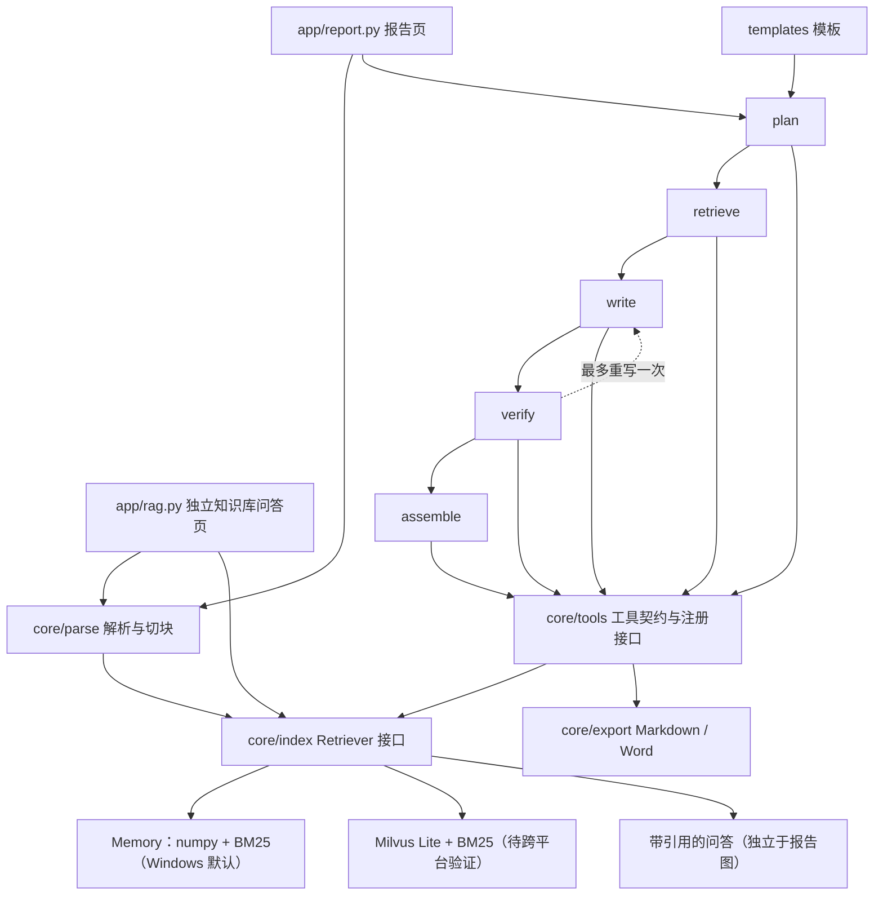

# doc2report-agent

文档 → 报告智能体：计划将上市公司公开年报 PDF 转为可溯源的企业经营分析报告，并导出 Word。

An open-source project for source-backed reports and standalone RAG Q&A over public annual reports.

本项目基于公开数据，与任何机构的内部系统无关。所有代码、提示词、样例均须原创。MIT License。

## 当前范围

第 5 轮任务 1（[graph-fix]）已完成：重写仅针对 needs_verification 章节；BM25 去停用词；relevance 复用存量向量。本地测试 **111 passed / 13 skipped**（Milvus 11 + export_report 2）。

第 2 轮已完成脚手架评审小改、`core/parse` 的 PDF 解析与切块，以及 `parse_document` 工具。第 3 轮任务 1 增加切块前页眉页脚去噪和 memory / milvus Retriever 骨架与契约测试。
默认使用 PyMuPDF，保留从 1 开始的物理页码，抽取文字、标题和表格；MinerU 可选，未安装、接口不兼容或执行失败时记录 warning 并回退。
第 3 轮已完成去噪、双 Retriever、混合召回、search_chunks 与独立 RAG 问答页。第 4 轮任务 1 已修拒答/引用校验阻断项；任务 2 已实现 LangGraph（plan→retrieve→write→verify→assemble）与年报分析模板。真实模型与 RTX 3050 推理尚未实测；任务 3 已实现 get_table、calc_financials 与 `python -m core.graph.run`；export_report、MCP、Word 导出留待后续。Milvus 适配代码已提供，原生 Windows 未实机运行。
约束以 [AGENTS.md](AGENTS.md) 为准，另见 [功能要求](docs/CODEX_PROMPT.md)、[工具规范](docs/TOOLS_SPEC.md)、[路线图](docs/ROADMAP.md)。

## 架构（规划）



## 目录与接口

- `app/`：报告入口与独立 RAG 入口占位。
- `core/parse/`：`parse_pdf(file_path, engine="pymupdf") -> ParsedDocument` 和 `chunk_document(document, min_chars=500, max_chars=800, overlap=100) -> list[Chunk]`。
- `core/export/`：导出模块占位。
- `core/index/retriever.py`：`Retriever.index_chunks(chunks)`、`search(query, doc_ids=None, top_k=8, mode="hybrid")`。
- `core/models.py`：片段、检索结果、来源、事实、模板及泛型工具返回结构。`Chunk` 含 `doc_id`、`section`、`page_end`（省略或为空时等于 `page`），`SearchHit` 继承 `Chunk` 并增加 `score`。
- `core/graph/state.py`：LangGraph 兼容的 TypedDict；每章包含事实、引用、核验、重写计数和耗时/token 字段。重写次数约定为 0 或 1，运行时限制尚未实现。
- `core/tools/`：8 个工具模块，模板模块含 2 个函数，共 9 个操作。
- `templates/`、`scripts/`、`tests/`：模板说明、下载/评估入口和测试骨架。

## 工具层

各函数接收对应 Pydantic `*Input`，返回 `*Output = ToolResult[*Data]`。各工具提供中英文描述及版本元数据。
统一结构：`{ok: bool, data: object|null, error: str|null, sources: [{file, page, chunk_id}]}`，页码从 1 开始。
`ToolResult` 已校验：成功时 `error` 必须为 `None`；失败时必须有非空错误信息且 `data` 为 `None`。
`parse_document` 已记录工具名、文件名/引擎参数摘要、耗时和成功状态；`registry.py` 当前仅定义注册、日志结构和 `list_tools()` 签名，统一分发和其他工具日志留待实现。

| 模块/操作 | 输入要点 | 输出要点 |
| --- | --- | --- |
| parse_document（已实现） | file_path、engine | doc_id、pages、sections、tables；新增 chunks、实际 engine |
| search_chunks（已实现） | query、doc_ids、top_k、mode；注入 Retriever | chunks，含 doc_id/章节/文本/评分/出处 |
| get_table（已实现） | doc_id、table_id 或 keyword | headers、rows、page、raw_text 回退 |
| calc_financials（已实现） | 各财务原值的 current/previous、来源 | Decimal 指标值、公式、输入值及来源 |
| verify_claim（已实现） | claim、source_chunk_ids | supported/not_found/mismatch、证据、差异 |
| render_section（已实现） | section_name、template_id、facts | 带引用的 Markdown |
| export_report | report_md、format、title | file_path |
| templates：list_templates / load_template（已实现） | 空输入 / template_id | 模板列表 / 完整模板 |

工具不直接访问网络；样例下载是文档允许的例外。模型调用与工具层的具体边界留待实现阶段设计。
MCP、自动生成工具文档、实际注册分发和统一调用日志尚未实现。

## 快速检查（3 步）

目标 Python 3.11+；本轮本机验证版本和结果见下文。

1. `python -m venv .venv`，激活虚拟环境（Windows：`.venv\Scripts\Activate.ps1`）。
2. `python -m pip install -e ".[dev]"`（含 PyMuPDF 和 pytest）。
3. `python -m pytest -q`。

解析与检索默认无需 API key。独立问答页可单独启动；未配置 `API_KEY` 时只展示检索结果。`app/report.py` 仍为占位。

## 解析与切块

```python
from core.parse import parse_pdf, chunk_document
from core.tools.parse_document import ParseDocumentInput, parse_document

document = parse_pdf("data/samples/public-report.pdf")  # 自行准备公开年报，不提交 PDF
chunks = chunk_document(document)
result = parse_document(ParseDocumentInput(file_path="data/samples/public-report.pdf"))
if result.ok:
    print(result.data.doc_id, result.data.pages, len(result.data.chunks))
else:
    print(result.error)
```

解析结果仅在内存中返回，不写文件或建立索引。`ParsedDocument.pages` 保留逐页原文和段落块，`tables` 保留表头、二维行数据、页码及 `raw_text`；工具按既有契约返回表格摘要。
`doc_id` 取 PDF 内容的 SHA-256，同一文件内容改名不改变文档身份；`chunk_id` 在相同内容和切块参数下稳定。

切块先按标题分组，再优先使用段落边界，其次句子边界，长段落按字符截断。默认 500–800 个 Python 字符（包含内部空白），同章节相邻片段重叠 100 字；短章节保留为短块，尾块不足 500 字时扩大重叠。片段可以跨页，以 `page` / `page_end` 标出实际原文范围，不跨标题混合正文。
标题采用字号与编号启发式识别；复杂多栏、目录、重复页眉和无边框表格可能识别不准。表格检测失败会记录 warning，页内原文仍保留。空白/扫描页保留页码，默认不启用 OCR，整份无可提取文字时记录 warning；缺失、损坏或需密码的 PDF 返回失败工具结果。

`chunk_document` 在分组前自动去噪，不修改传入的解析原文。PyMuPDF 提供页面顶部/底部各 10% 高度内的候选行；无坐标时，以至少有 3 行的页面首尾非空行作为候选。同一规范化行在全部页面的 ≥30% 且至少 2 个不同页面出现时，剔除首尾连续匹配行，正文内部同名行保留。纯数字和“第 N 页”等独立页码统一匹配；不替换正文中的数字。空白页计入比例分母，单页不去重。
**低置信/待人工抽查**：10% 边缘范围、无坐标首尾行与页码归一化都是启发式，可能误删反复出现的边缘正文，或漏掉混合文本页码；尚未用真实公开年报验证。

## Retriever 与 search_chunks（第 3 轮任务 2）

```python
from core.index import get_retriever
from core.tools.search_chunks import SearchChunksInput, search_chunks

# 先安装 embedding extra 并准备本地模型；纯流程测试可设 EMBEDDING_BACKEND=fake
retriever = get_retriever("memory")
retriever.index_chunks(chunks)
hits = retriever.search("营业收入", doc_ids=None, top_k=8, mode="hybrid")
result = search_chunks(SearchChunksInput(query="营业收入"), retriever=retriever)
print(result.model_dump())
```

- 选择优先级：显式参数 > 环境变量 `RETRIEVER` > 平台默认。原生 Windows 默认 `memory`；Linux/macOS/WSL 默认 `milvus`。不会自动读取 `.env`；测试通过 fixture 强制环境默认 `memory`，参数化用例显式选择后端。
- `memory` 使用 numpy 余弦和 rank-bm25；本轮仅内存存储，未做可选 pickle。`index_chunks` 按 chunk_id 更新，空输入不清空；`doc_ids=[]` 不匹配任何文档。空查询返回空列表，非法 mode 或 top_k < 1 抛 ValueError。
- 两后端均支持 vector（余弦）、bm25（jieba + rank-bm25）和 hybrid。RRF 分数为两路 `1/(60+rank)` 之和，排名从 1 开始；先过滤文档，对全部候选分别排名、融合，再取 top_k。同分按 chunk_id 排序，零分候选也参与排名；分数不是置信度。当前面向小规模会话，BM25 每次查询重建。
- 默认 `EMBEDDING_BACKEND=local`、`EMBEDDING_MODEL=BAAI/bge-small-zh-v1.5`。安装 `python -m pip install -e ".[embedding]"`；首次使用前独立运行 `python -c "from sentence_transformers import SentenceTransformer; SentenceTransformer('BAAI/bge-small-zh-v1.5')"` 准备公开模型，或把 EMBEDDING_MODEL 设为已有本地模型目录。运行时 `local_files_only=True`，模型缺失时失败，不隐式联网下载。
- 设备自动选择：torch 检测 CUDA 可用则 `cuda`，否则 `cpu`；`EMBED_DEVICE=cpu` / `cuda` / `cuda:0` 可覆盖。不会吞掉设备错误或回退假向量。使用 [SentenceTransformer 官方 API](https://www.sbert.net/docs/package_reference/sentence_transformer/model.html)，本轮仅以替身验证设备分支。
- 测试 fixture 强制 `EMBEDDING_BACKEND=fake`；也可通过 `embedder=` 注入 `EmbeddingProvider` 批量 callable。假向量使用稳定 hash，只用于测试，不代表语义检索质量。默认依赖无需 torch/sentence-transformers；本轮支持 fake/local，未实现 openai embedding 后端。
- search_chunks 仅依赖 Retriever，返回 ok/data/error/sources；命中保留 doc_id、file、page/page_end、section、chunk_id、score、text。异常转换为失败结果；日志记录查询长度、文档数量、mode、top_k、耗时和 ok，不记录完整查询。输入模型校验错误在调用前由 Pydantic 抛出。
- `milvus` 在支持平台执行 `python -m pip install -e ".[dev,milvus]"`，再设置 `RETRIEVER=milvus`；原生 Windows 显式选择时抛 RuntimeError，提示改用 memory 或在 Docker 内运行应用。无需在本机安装 extra。
- Milvus 默认文件为已忽略的 `data/index/milvus.db`，每个实例使用独立临时 collection，需重新索引；结束时调用实例 `close()` 删除该 collection 并关闭连接。BM25 元数据仅在内存，不支持重启恢复，意外退出可能留下 collection。本轮没有持久化恢复或大规模性能承诺。
- Milvus 使用官方 [create_collection](https://milvus.io/api-reference/pymilvus/v3.0.x/MilvusClient/Collections/create_collection.md)、[upsert](https://milvus.io/docs/upsert-entities.md) 与 [search](https://milvus.io/api-reference/pymilvus/v2.6.x/MilvusClient/Vector/search.md) 接口；本机仅验证 Windows 错误提示，真实客户端调用待支持平台跑同组契约测试。

可选开关为 `ParseDocumentInput(engine="mineru", ...)` 或 `parse_pdf(..., engine="mineru")`；默认依赖不安装 MinerU。本轮适配 [MinerU 4 本地 SDK](https://opendatalab.github.io/MinerU/usage/sdk_api/) 的 Flash/txt 模式，并通过 [Content List 渲染格式](https://opendatalab.github.io/MinerU/reference/output_files/) 保留原页码和表格原始标记；不支持的版本会记录原因并回退 PyMuPDF。表格原始标记暂不转换为二维单元格。`.env.example` 中 `PARSER` 的环境变量自动加载留待应用层实现。
PyMuPDF 文字和表格抽取接口见 [官方 Page 文档](https://pymupdf.readthedocs.io/en/latest/page.html)。

## 单独启动问答页

先安装问答依赖：`python -m pip install -e ".[dev,qa]"`。在项目根目录复制 `.env.example` 为 `.env` 并填写 `API_KEY`（可选；不填则只显示检索命中）。不要提交 `.env`。

Windows cmd：

```bat
cd /d C:\Workplace\Work\30.doc2report-agent
.venv\Scripts\activate.bat
streamlit run app\rag.py
```

Linux / WSL：

```bash
cd /path/to/doc2report-agent
source .venv/bin/activate
streamlit run app/rag.py
```

页面流程：上传或填写本机 PDF 路径 → 解析入库（memory Retriever）→ 提问 → 混合检索 → 有 Key 则调用 OpenAI 兼容接口回答并标注 `[文件名 p页码]`，可展开命中原文；无依据时拒答；无 Key 时提示配置并只展示检索结果。

## 配置与模板


`.env.example` 预留 `BASE_URL`、`API_KEY`、`MODEL=deepseek-flash`、`RETRIEVER=milvus`、解析器及 embedding 配置。
本地 embedding 默认 `BAAI/bge-small-zh-v1.5`，配置见上节；环境变量由调用方设置，不自动读取 .env。预留的 EMBEDDING_BASE_URL/API_KEY 本轮不使用。
**低置信/待验证**：`MODEL_THINKING=false` 是项目拟定配置约定，尚未映射或验证供应商请求参数。
模板数据结构为 `template_id`、`title`、`sections[{name, questions, keywords}]`；后续在 `templates/` 添加 YAML 并实现加载器。

## 测试与未验证项

第 4 轮任务 2 验证（2026-10-27）：`python -m pytest -q -rs` → **95 passed, 26 skipped**。假模型覆盖正常 / 重写一次 / 仍待核实。

第 4 轮任务 3 验证（2026-10-27）：`python -m pytest -q -rs` → **107 passed, 13 skipped**（Milvus 11 + export_report 2）。

报告 CLI：`python -m core.graph.run --pdf <公开年报路径>`（需 `.env` 中 `API_KEY`；输出到已忽略的 `output/`）。

第 4 轮任务 1 验证（2026-10-27，实现环境 Linux / Python 3.13.5；目标机 Windows / Python 3.12.10）：

```bash
python -m pytest -q -rs
```

- **91 passed, 26 skipped, 0 failed**。新增：编造页码/无引用/模型自拒/全部不相关四类问答拒答，以及相关性门槛与查询前缀单测。
- 26 skipped 仍为 Milvus 契约（非 win 需 milvus extra）+ 引用核验占位 1 + 其他工具占位 14。
- 测试使用假 embedding／假模型，未下载模型、未使用 GPU。`MIN_VECTOR_SCORE` 默认 0.35 为待实测经验值。


第 3 轮任务 2 验证（2026-10-27，Windows / Python 3.12.10）：

```powershell
.venv\Scripts\python.exe -m pytest -q -rs --basetemp=C:\Workplace\Work\30.doc2report-agent\.tmp\pytest
```

- 检索实现后的原有回归：**62 passed, 24 skipped**；补充检索/工具测试后：**77 passed, 26 skipped, 0 failed**。
- 26 skipped = Milvus 契约 11 项（Windows 不支持）+ 引用核验 1 项 + 其他工具 14 项。search_chunks 已无 skip；其他工具 skip 不变。
- 有 1 个 `.pytest_cache` 权限 warning，不影响结果；使用指定 basetemp，无 setup 错误。
- 本机有 RTX 3050（用户提供），测试全部使用假 embedding/模型替身，未使用 GPU、未下载模型。覆盖中文三模式、RRF 精确分值、来源保留、过滤、工具错误与日志及 CUDA/CPU/覆盖配置分支。去噪回归通过。
- **未验证 / 低置信**：真实公开年报召回质量、本地模型与 RTX 3050 实际运行、Milvus 实机兼容性与性能，需人工验收。详见 [任务 2 开发记录](docs/devlog/2026-10-r3-retrieval.md)。任务 3 已用假模型覆盖问答拒答/引用/无 Key 仅检索链路，见 `tests/test_qa.py`。 任务 3 本地复跑：`.venv/bin/python -m pytest -q -rs` → **84 passed, 26 skipped**（Linux 同步环境；Windows 笔记本复跑结果以提交信息为准）。

第 3 轮任务 1 验证（2026-10-27，原生 Windows / Python 3.12.10，仓库 `.venv`，不使用 GPU）：

```powershell
$env:PYTEST_ADDOPTS='--basetemp=.tmp/r3-index-final -o cache_dir=.tmp/pytest-cache'
.venv\Scripts\python.exe -m pytest -q -rs
```

- 去噪模块完成后：**53 passed, 18 skipped, 0 failed**。
- Retriever 模块完成后及最终复跑：**62 passed, 24 skipped, 0 failed**。
- 24 skipped = Milvus 同组参数化契约 7 项（原生 Windows 不支持）+ 引用核验占位 1 项 + 范围外工具占位 16 项。memory 契约不跳过，search_chunks 工具保持占位。
- 首次直接运行因旧系统 pytest 临时目录权限失败：33 passed, 18 skipped, 20 errors（setup 阶段），并有旧缓存目录权限警告。用上面的环境变量换到已忽略的 `.tmp/` 后通过，不修改目录 ACL 或清理用户文件。
- 未验证：Milvus 在 Linux/macOS/WSL 的真实运行、真实公开年报去噪效果、检索质量/性能、真实 embedding；没有下载模型或使用 GPU。详情见 [开发记录](docs/devlog/2026-10-r3-index.md)。

第 2 轮历史验证（2026-10-25，Windows / Python 3.11.5，PyMuPDF 1.28.2，Pydantic 2.14.1）：

- 解析模块完成后：`.venv\Scripts\python.exe -m pytest -q` → **28 passed, 21 skipped**。
- 切块和工具接通后：同一命令 → **51 passed, 18 skipped**。
- `tests/conftest.py` 使用 PyMuPDF 在 pytest 临时目录现场生成原创小 PDF，覆盖中文标题、跨页正文和带边框表格，不提交任何 PDF。
- 已覆盖工具成功/失败结构、页码/章节/表格、稳定 ID、500–800 字切块及重叠/正文完整性、短章节隔离、损坏/缺失/加密文件、空白页、表格失败保留原文，以及 MinerU 缺失/运行失败回退与日志。
- 切块及 `parse_document` 的 skip 已解除；剩余 18 个跳过项为检索、引用核验占位及其余 8 个工具操作各 2 个正例/异常例占位。

未验证：真实安装 MinerU 的端到端运行及其本地资源依赖（适配器仅用替身测试，缺失回退已验证）、真实年报/扫描件 OCR/复杂跨页表格、多栏阅读顺序、Milvus Lite 实机检索、引用核验、模型名及非思考参数、独立 RAG 页、导出、Docker 与 MCP。Python 3.11 为历史验证，本轮使用 Python 3.12。
评估计划：引用覆盖率、待核实数字占比、每章耗时及 token 用量（`scripts/eval.py` 仅入口）。

## 展示与后续

效果截图：待 Demo 实现后补充。继续按每轮最多 2 个模块推进。
v1 补全报告流程及独立问答；后续考虑多文档对比、表格问答、Elasticsearch 检索、权限与私有化部署。
不提交密钥、PDF、向量库文件和导出的 Word。
