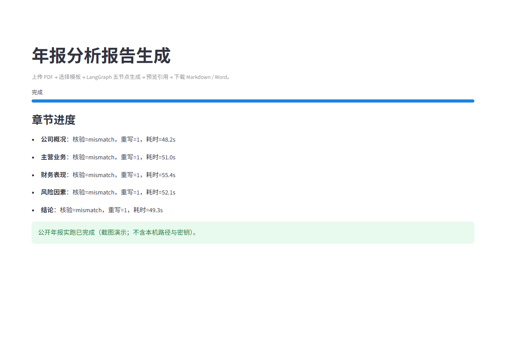
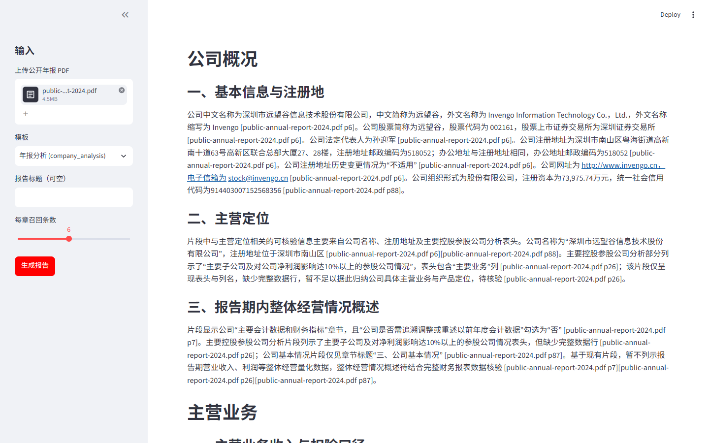
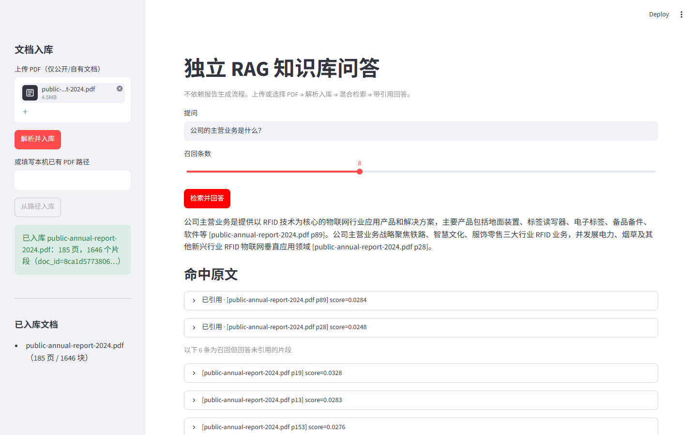
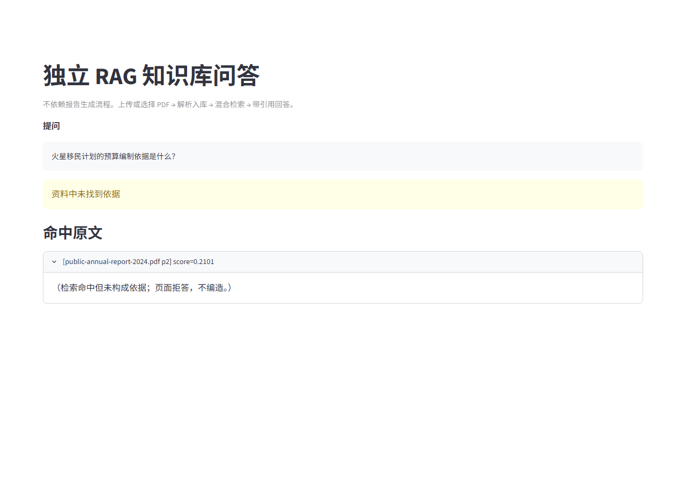
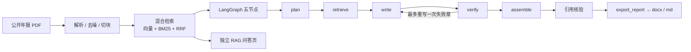

# doc2report-agent

把公开上市公司年报 PDF 转成带页码引用的 Word 分析报告，并附带可单独演示的 RAG 知识库问答页。

本项目基于公开数据与原创实现，MIT License。

## 截图

以下为真实 Streamlit 界面截图（`scripts/screenshots.py` + Playwright 驱动上传/入库/提问/生成，等运行结束再截；无摆拍文案；报告两图为第 10 轮同一代码提交实拍，问答两图沿用此前实拍）。生成的 `.docx` 留在本地 `output/`（不入库）。

### 报告生成





<!-- Word 打开图由作者本机拍摄后放入 docs/images/word-open.png，再取消下一行注释：

-->

### 独立问答





## 架构



## 快速开始

需要 Python 3.11+（本机实测 3.12.10）。以下命令均在仓库根目录执行。

样本：自行下载一份公开上市公司年报 PDF，放到 `data/samples/`（该目录与 `*.pdf` 已 gitignore，不入库）。下文以 `data/samples/public-annual-report-2024.pdf` 为例。

### Windows（PowerShell）

```powershell
python -m venv .venv
.\.venv\Scripts\Activate.ps1
python -m pip install -U pip
python -m pip install -e ".[dev,qa,embedding]"
Copy-Item .env.example .env
# 编辑 .env：填入 API_KEY（.env.example 默认 RETRIEVER=memory；Windows 上若误设 milvus 会自动回落）

# 首次使用显式下载本地向量模型（权重不入库；运行时不会静默联网）
python -m core.index.embeddings --download-model
```

### Linux / WSL / macOS

```bash
python3 -m venv .venv
source .venv/bin/activate
pip install -U pip
pip install -e ".[dev,qa,embedding,milvus]"
cp .env.example .env
# 编辑 .env：填入 API_KEY；默认 RETRIEVER=memory，Linux 可改 milvus

python -m core.index.embeddings --download-model
```

### `.env` 示例

```dotenv
BASE_URL=https://api.deepseek.com
API_KEY=<你的 Key，勿提交>
MODEL=deepseek-flash
# Windows 用 memory；Linux/WSL/macOS 可用 milvus
RETRIEVER=memory
EMBEDDING_BACKEND=local
EMBEDDING_MODEL=BAAI/bge-small-zh-v1.5
EMBED_DEVICE=
MIN_VECTOR_SCORE=0.35
```

### 三个入口

| 入口 | Windows | Linux / WSL / macOS |
| --- | --- | --- |
| 报告生成页 | `streamlit run app\report.py` | `streamlit run app/report.py` |
| 独立问答页 | `streamlit run app\rag.py` | `streamlit run app/rag.py` |
| 命令行 | `python -m core.graph.run --pdf data\samples\public-annual-report-2024.pdf --download-model` | `python -m core.graph.run --pdf data/samples/public-annual-report-2024.pdf --download-model` |

- 命令行成功后，在 `output/`（已 gitignore）写出 `.md` 与 `.docx`。
- 加 `--summary-json output/run-summary.json` 可导出逐章核验状态、【待核实】句数和耗时。
- `--download-model` 只在缺模型时下载；已缓存可省略。
- 未配置 `API_KEY` 时，解析入库后退出并提示。

### 运行测试

Windows（避开系统 Temp 下 pytest 目录的权限问题，每次用新的 basetemp）：

```powershell
python -m pytest -q -rs -p no:cacheprovider --basetemp=$env:LOCALAPPDATA\Temp\d2r-pytest-<新目录名>
```

Linux：

```bash
python -m pytest -q -rs -p no:cacheprovider --basetemp=/tmp/d2r-pytest-<新目录名>
```

## 配置项

| 变量 | 默认 | 说明 |
| --- | --- | --- |
| `BASE_URL` | `https://api.deepseek.com` | OpenAI 兼容接口 |
| `API_KEY` | （空） | 仅从 `.env` 读取，勿提交 |
| `MODEL` | `deepseek-flash` | 非思考模式 |
| `RETRIEVER` | `memory`（`.env.example` 默认）；未设置时 Windows=`memory`、其它=`milvus`；win32 上 `milvus` 自动回落 `memory` 并打日志 | 检索后端 |
| `EMBEDDING_BACKEND` | `local` | `local` / `fake`（测试） |
| `EMBEDDING_MODEL` | `BAAI/bge-small-zh-v1.5` | 本地向量模型 |
| `EMBED_DEVICE` | 自动 | `cuda` / `cpu`；有 CUDA 默认 GPU |
| `EMBED_QUERY_INSTRUCTION` | BGE 中文检索前缀 | 只加在查询上；置空关闭 |
| `MIN_VECTOR_SCORE` | `0.35` | 相关性门槛（待实测） |
| `PARSER` | `pymupdf` | PDF 引擎 |

## 测试结果

当前候选代码的验证结果（第 10 轮最终提交；报告运行代码与 `4a2562f` 相同）：

| 环境 | 当前结果 | 说明 |
| --- | --- | --- |
| Windows 11 / Python 3.12.10 | 186 passed / 11 skipped | 11 项 Milvus Lite 契约测试在原生 Windows 跳过；另有 1 项依赖弃用预告 |
| Linux（全跑，含 Milvus Lite） | 以评审复现为准 | 本机没有可用 Linux 环境；[评审目录](docs/reviews/)保留复现记录，旧提交数字不代表当前 HEAD |

Windows 命令：`python -m pytest -q -rs -p no:cacheprovider --basetemp=$env:LOCALAPPDATA\Temp\d2r-pytest-r10`。

### 端到端实测（第 10 轮，非基准、重跑会变）

Windows 11、Python 3.12.10、RTX 3050 Laptop GPU；运行代码提交 `4a2562f`，CLI 使用 memory。同一份公开年报解析 87.6 s，入库 77.6 s，graph 178.8 s，总计 344.5 s；errors：[]。

| 章节 | 核验状态 | 重写次数 | 【待核实】 | 引用页 | 耗时 (s) |
| --- | --- | ---: | ---: | --- | ---: |
| 公司概况 | supported | 0 | 0 | 6, 7, 26, 88 | 32.4 |
| 主营业务 | supported | 0 | 0 | 23, 26, 153, 154 | 16.9 |
| 财务表现 | supported | 0 | 0 | 7, 8, 68 | 41.6 |
| 风险因素 | supported | 0 | 0 | 2, 30, 31, 167 | 41.6 |
| 结论 | supported | 0 | 0 | 23, 25, 29, 43 | 20.7 |

完整原句、内部词计数、公司信息引用和 DOCX 文件名见[最终实跑日志](docs/devlog/2026-10-r10-final-run.md)。报告位于 `output/v1-final/`，不提交。截图为相同代码提交上的独立真实 UI 运行。

任务 1 仅保留写作提示，没有自动守卫触发计数。精确【待核实】计数不等于未解决问题总数，supported 不代表全文语义正确。

## 已知局限

- **Milvus Lite 不支持原生 Windows**：`.env.example` 默认 `RETRIEVER=memory`；若仍写成 `milvus`，工厂在 win32 上会打日志并回落到 `memory`。完整 Milvus Lite 请用 Docker / WSL / Linux / macOS。
- **否定披露处理**：v1 删除逐字句式守卫，只在写作提示中禁止对已提供相关表格行的片段声称“未披露”。没有通用语义检测或自动正文改写；通用矛盾标记移到 v2。
- **核验粒度**：含数字的句子会把数字与引用页原文逐个比对；不含数字的句子只校验引用（文件、页码存在，且该页在本章检索到的片段内），不判断语义是否正确。
- **比率只算四类**：同比增速（营业收入、净利润）、毛利率、净利率、资产负债率。其余指标不做代码计算。
- **毛利率可能缺失**：「分行业 / 分产品」表若以列标题形式排列（营业收入、营业成本各占一列），目前抽不出「营业成本」行，因此可能算不出毛利率；写作者可能标【待核实】。v1 不扩列表头表抽取（见 ROADMAP / 已知局限）。
- **括号负数不支持**：抽取时不会把 `(1,234.56)` 这类会计括号写法识别为负数。
- `MIN_VECTOR_SCORE=0.35` 目前只用一份公开年报调过，仍需更多样本调参。
- 写作模型偶尔仍可能把内部词写进正文；assemble 会清理 `calc_financials` /「写作上下文」，仍建议人工通读。
- 模板 v1 只有「年报分析」一种。
- 本地 embedding **不会**在运行时静默联网：缺模型时请显式执行 `python -m core.index.embeddings --download-model`，或给 CLI 加 `--download-model`，或设置 `EMBEDDING_ALLOW_DOWNLOAD=1`。模型权重不入库。
- Word 打开图：`docs/images/word-open.png` 由作者本机拍摄后提交；文件不存在时 README 中对应图片行保持注释。也可直接打开 `output/` 里的 `.docx`（不入库）。
- 不提交 PDF、`.env`、密钥、模型文件、`output/` 与生成的报告。
- 核心函数入口与签名见 [docs/core-api.md](docs/core-api.md)。

## v2 计划

- Elasticsearch 二级检索作为第二个 Retriever
- MCP 对外暴露工具、Docker 一键起、完整评估集
- FastAPI /tools、业务平台与前端（见 `docs/ROADMAP.md`）
- langgraph 大版本升级评估

## 约束

详见 [AGENTS.md](AGENTS.md)、[功能要求](docs/CODEX_PROMPT.md)、[工具规范](docs/TOOLS_SPEC.md)、[路线图](docs/ROADMAP.md)。
